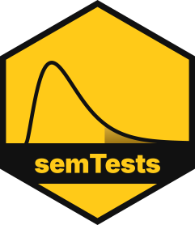

<!-- README.md is generated from README.Rmd. Please edit that file -->

```{r, include = FALSE}
knitr::opts_chunk$set(collapse = TRUE, comment = "#>")
```

# semTests 

[](https://cran.r-project.org/package=semTests)
[](https://github.com/JonasMoss/semTests/actions/workflows/R-CMD-check.yaml)
[](https://app.codecov.io/gh/JonasMoss/semTests?branch=main)
[](https://www.repostatus.org/#active)

`semTests` computes robust *p*-values for structural equation models fitted
with `lavaan`: tests of overall fit, nested model comparisons, and score and
criterion-difference tests of parameter restrictions. It implements penalized
eigenvalue block averaging and penalized regression
([Foldnes, Moss, and Grønneberg, 2025](https://doi.org/10.1080/10705511.2024.2372028))
and their extension to nested models
([Foldnes, Grønneberg, and Moss, 2026](https://doi.org/10.3758/s13428-026-02968-4)).
It supports ML, GLS, ULS, categorical DWLS and ULS, and FIML, with one or
several groups.

## Installation

```{r, eval = FALSE}
install.packages("semTests")
# Development version:
# remotes::install_github("JonasMoss/semTests")
```

## Example

```{r example}
library("semTests")
model <- "visual  =~ x1 + x2 + x3
          textual =~ x4 + x5 + x6
          speed   =~ x7 + x8 + x9"
fit <- lavaan::cfa(model, lavaan::HolzingerSwineford1939)
pvalues(fit)
```

To test a restriction, fit the restricted model and pass it first:

```{r nested}
restricted <- "visual  =~ x1 + a*x2 + a*x3
               textual =~ x4 + x5 + x6
               speed   =~ x7 + x8 + x9"
fit0 <- lavaan::cfa(restricted, lavaan::HolzingerSwineford1939)
pvalues_nested(fit0, fit)
semtest(fit0, fit)
```

## Learn more

- `vignette("semTests", package = "semTests")`: getting started
- `vignette("categorical-data", package = "semTests")`: ordinal indicators
  and measurement invariance
- `vignette("fiml-missing-data", package = "semTests")`: missing data with
  FIML
- `vignette("score-criterion", package = "semTests")`: score and criterion
  tests

`?semTests-support` lists every supported combination, and
`citation("semTests")` shows how to cite the package. Bugs and ideas go to
[GitHub issues](https://github.com/JonasMoss/semTests/issues).
